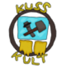

<p align="center">
  
</p>

<h1 align="center">Das Geile Wholeplay Skript</h1>

<p align="center">
  <em>Eine FiveM Lua Resource für das Kuss Kult Universum</em>
</p>

<p align="center">
  <a href="#english-summary">English Summary</a> · 
  <a href="#was-ist-das-geile-wholeplay">Was ist das?</a> · 
  <a href="#features--funktionen">Features</a> · 
  <a href="#installation">Installation</a> · 
  <a href="#befehlsübersicht--command-reference">Befehle</a>
</p>

---

## Was ist das Geile Wholeplay?

Das **Geile Wholeplay** ist eine spezielle Abwandlung von Roleplay und beinhaltet das erfolgreiche Immersieren in das **Kuss Kult Universum** für alle Beteiligten. Das Kuss Kult Universum ist eine Zusammenkunft von allen Ideen, die im Laufe der Zeit durch die Mitglieder der Kuss Kult Gruppe entstanden sind.

Die erfolgreiche Immersion wird erlangt, indem die Beteiligten wie in einem richtigen Roleplay in Rollen schlüpfen. Der Hauptunterschied besteht dabei, dass diese Rollen aus dem Kosmos des Kuss Kult Universums stammen und auch in diesen passen. Weitere wesentliche Aspekte sind die **Improvisation** von Situationen, **Kreativität** und eine gesunde Mischung aus **Spaß** und einer lockeren Ernsthaftigkeit.

Das Geile Wholeplay lebt durch Lacher und soll in erster Linie Spaß machen. Das Fortschreiben der Kuss Kult Geschichte ist zwar wichtig und ab und zu eine geskriptete Sequenz für wichtige Ereignisse lässt sich nicht vermeiden, doch die Geschichte durch den gemeinsamen, vielleicht etwas unsinnigen, Spaß zu definieren, ist ein wenig lustiger.

Um die Organisation von dem Geilen Wholeplay einfacher zu machen, wurde dieses **Skript** als eigens entwickelte Resource für die Multiplayer-Modifikation [FiveM](https://fivem.net/) konzipiert.

> ©️ Der Kuss Kult Kurator stellt den Verwalter des Kuss Kult Universum dar und ist der Inhaber dieses Repositories

> 📄 Eine ausführliche Anleitung findet sich in der PDF-Dokumentation: **„Anleitung zum Geilen Wholeplay (Skript in FiveFM)"**

---

## Features / Funktionen

### 🎭 Charakter-Spawning
- **200+ Charaktere** aus dem Kuss Kult Universum, jeder mit individuellem Aussehen, Kleidung und optionaler Waffe
- **Skin-Varianten** — Viele Charaktere besitzen alternative Outfits (z.B. College, Winter, Urlaub, Kampfanzug)
- Spawn als **Spieler**, **Neutraler NPC**, **Buddy** oder **Gegner**
- Zufälligen Charakter spawnen mit `/gwrandomped`

### 🚗 Fahrzeug-Spawning
- **100+ Fahrzeuge** mit individuellen Farben, Tuning, Kennzeichen und Extras
- Eigenes Fahrzeug des aktuellen Charakters spawnen mit `/gwspawnmycar`
- Zufälliges Fahrzeug mit `/gwrandomcar`

### 🖥️ F6 Menü (NUI)
Das interaktive Spawn-Menü wird mit **F6** geöffnet und bietet:
- Tabs für **Charaktere**, **Fahrzeuge**, **Fraktionen**, **Orte**, **Dioramen** und **Meine Fahrzeuge**
- **Suchfunktion** (Fokus mit `F`) zum schnellen Finden von Einträgen
- Direktes Spawnen, Löschen, Teleportieren und Gruppenverwaltung per Klick

<!-- TODO: Screenshot des F6 Menüs hier einfügen -->
<!--  -->

### ⌨️ F7 Quick-Spawn
Mit **F7** öffnet sich ein Schnelleingabefeld — einfach den Charakter- oder Fahrzeugnamen eingeben und sofort spawnen.

### 🎬 Dioramen
- **10+ vordefinierte Szenen** (z.B. McFredag, Dunes Ranch, Polizeistation, TV Total Egal Redaktion)
- Szenen platzieren alle zugehörigen Charaktere und Fahrzeuge an ihren vordefinierten Positionen
- Eigene Dioramen speichern und laden mit `/gwsavediorama` und `/gwplacediorama`

### ⚔️ Fraktionssystem
- Charaktere können in Fraktionen gruppiert und als **Neutral**, **Buddy** oder **Gegner** eingestellt werden
- Ganze Fraktionsgruppen auf einmal spawnen mit `/gwspawngruppe`
- Spieler-zu-Spieler Beziehungen steuern mit `/gwfreunde` und `/gwfeinde`

### 🚐 Fahrer-System (Drivers)
- **Fahrgemeinschaften** erstellen: Fahrzeug + Fahrer + Passagiere
- Verhalten steuern: `DRIVETOCOORDS`, `ESCORT`, `CHASE`, `GETINVEHICLE`, `GETOUTOFVEHICLE`
- NPC-Konvois erstellen, die den Spieler eskortieren oder verfolgen

### 📍 Teleport-System
- Map-Blips für wichtige Orte im Kuss Kult Universum
- Teleportation mit `/gwtp LocationName`
- Spawn-Punkte mit `/gwspawnpoint` setzen und mit `/gwclearspawnpoint` zurücksetzen

### 🔌 Optionale Integrationen
- **qbx_vehiclekeys** — Fahrzeugschlüssel-System (QBox)
- **ox_inventory** — Waffeninventar-Integration

---

## Spielmodi / Game Modes

### 🏆 Kuss Kult Knockout
Der erste Spielmodus, entstanden durch die Fähigkeit zufällige Kuss Kult Fahrzeuge zu spawnen.

**Prämisse:** Jeder Spieler erhält einen zufälligen Kuss Kult Charakter und ein zufälliges Kuss Kult Fahrzeug. Das Ziel ist es, der Letzte zu sein, der sein Fahrzeug noch fahren kann. Die Fahrmöglichkeit der Gegner muss also zerstört werden — ob durch Rammen, Explosionen oder andere kreative Wege in GTA 5 bleibt jedem selbst überlassen.

Starten mit: `/gwkusskultknockout`

<!-- TODO: Screenshot / Bild vom Jahresabschluss hier einfügen -->
<!--  -->

### 🔍 Twouble in Kuss Kult
Inspiriert von **Trouble in Terrorist Town**. Die Spieler werden in Rollen aufgeteilt:
- **Innocents** — Müssen die Terroristen entlarven und überleben
- **Terroristen** — Müssen unerkannt alle Innocents eliminieren
- **Detektive** — Haben spezielle Ausrüstung um die Terroristen zu finden

Jede Rolle bekommt ein eigenes Waffen-Loadout. Starten mit: `/gwtwoubleinkusskult`

> 📄 Eine ausführliche Anleitung zu beiden Spielmodi findet sich in der PDF: **„Anleitung zum Geilen Wholeplay (Skript in FiveFM)"**

---

## Installation

### Voraussetzungen
- Ein [FiveM](https://fivem.net/) Server (empfohlen mit [txAdmin](https://txadmin.gg/))
- Windows- oder Linux-basierter Server

### Schritte

1. **Resource herunterladen** — Dieses Repository klonen oder als ZIP herunterladen
   ```
   git clone https://github.com/Profdocka/GeilesWholeplaySkript.git
   ```

2. **In den Resources-Ordner legen** — Die Resource in den `resources/`-Ordner des FiveM Servers kopieren

3. **In server.cfg aktivieren** — Folgende Zeile zur `server.cfg` hinzufügen:
   ```
   ensure GeilesWholeplaySkript
   ```

4. **Server starten** — Das Skript lädt alle Charaktere, Fahrzeuge und Dioramen automatisch beim Serverstart

### Optionale Abhängigkeiten

| Resource | Funktion |
|---|---|
| [qbx_vehiclekeys](https://github.com/Qbox-project/qbx_vehiclekeys) | Fahrzeugschlüssel-System — erlaubt `/gwkeys` für Schlüsselvergabe |
| [ox_inventory](https://github.com/overextended/ox_inventory) | Waffeninventar — Waffen werden als Items ins Inventar gelegt |
| baseevents | Benötigt für den Twouble-Spielmodus (Tod-Erkennung) |
| chat | Benötigt für Befehlsbeschreibungen im Chat |

---

## Befehlsübersicht / Command Reference

### Spawning

| Befehl | Beschreibung | Parameter |
|---|---|---|
| `/gwspawnplayer` | Spieler in einen Charakter verwandeln | `VornameNachname` |
| `/gwspawnneutral` | Neutralen NPC spawnen | `VornameNachname` `?true` (Waffe) |
| `/gwspawnbuddy` | Buddy-NPC spawnen | `VornameNachname` `?true` (Waffe) |
| `/gwspawngegner` | Gegner-NPC spawnen | `VornameNachname` `?true` (Waffe) |
| `/gwspawngruppe` | Ganze Fraktion spawnen | `Fraktionsname` `buddy/gegner` `?true` (Waffe) |
| `/gwspawnvehicle` | Fahrzeug spawnen | `NachnameFahrzeugmodell` |
| `/gwspawnmycar` | Eigenes Charakter-Fahrzeug spawnen | — |
| `/gwrandomped` | Zufälligen Charakter spawnen | — |
| `/gwrandomcar` | Zufälliges Fahrzeug spawnen | — |
| `/gwjahresabschluss` | Alle Charaktere im Kreis spawnen | `?Gesinnung` |

### Kontrolle / Control

| Befehl | Beschreibung | Parameter |
|---|---|---|
| `/gwswitch` | Zu einem anderen Charakter wechseln | `VornameNachname` |
| `/gwchangeskin` | Verkleidung/Skin des Charakters wechseln | `?index` |
| `/gwdropsingle` | Einzelnen Charakter/Fahrzeug löschen | `VornameNachname` |
| `/gwdropallpeds` | Alle Charaktere löschen | — |
| `/gwdropallcars` | Alle Fahrzeuge löschen | — |
| `/gwdropeverything` | Alles löschen | — |
| `/gwdropdead` | Tote/kaputte Entities löschen | — |
| `/gwlistall` | Alle aktiven Entities auflisten | — |
| `/gwreskin` | Alle Skins neu laden | — |
| `/gwstopall` | Alle Charaktere stoppen | — |
| `/gwr` | Eigenen Charakter neu laden | — |
| `/gwrevievesingle` | Toten Charakter wiederbeleben | `VornameNachname` |
| `/gwkeys` | Fahrzeugschlüssel erhalten | — |

### Fraktionen / Factions

| Befehl | Beschreibung | Parameter |
|---|---|---|
| `/gwgesinnungneutral` | Gesinnung auf neutral setzen | `VornameNachname` |
| `/gwgesinnungbuddy` | Gesinnung auf freundlich setzen | `VornameNachname` |
| `/gwgesinnunggegner` | Gesinnung auf aggressiv setzen | `VornameNachname` |
| `/gwsetownfaction` | Eigene Fraktionszugehörigkeit ändern | `?Fraktionsname` |
| `/gwfreunde` | Alle Spieler zu Freunden machen | — |
| `/gwfeinde` | Alle Spieler zu Feinden machen | — |

### Dioramen / Dioramas

| Befehl | Beschreibung | Parameter |
|---|---|---|
| `/gwsavediorama` | Aktive Szene als Diorama speichern | `Name` |
| `/gwplacediorama` | Diorama in der Welt platzieren | `Name` `?Gesinnung` |

### Spielmodi / Game Modes

| Befehl | Beschreibung | Parameter |
|---|---|---|
| `/gwkusskultknockout` | Kuss Kult Knockout starten | — |
| `/gwtwoubleinkusskult` | Twouble in Kuss Kult starten | — |
| `/gwstopkusskultgame` | Aktives Spiel stoppen | — |
| `/gwcountdown` | Countdown starten | `?Dauer` (ms, Standard: 5 Min) |
| `/gwcancelcountdown` | Countdown abbrechen | — |

### Fahrer / Drivers

| Befehl | Beschreibung | Parameter |
|---|---|---|
| `/gwdrivers` | Fahrgemeinschaft erstellen | `Fahrzeug` `Fahrer` `?Passagiere...` |
| `/gwdriversupdate` | Fahrgemeinschaft aktualisieren | `Fahrzeug` `Fahrer` `?Passagiere...` |
| `/gwdriverstask` | Verhalten der Fahrgemeinschaft setzen | `Fahrzeug` `Task` `?Ziel` |
| `/gwspawndrivers` | Fahrzeug mit Fahrern spawnen | `Fahrzeug/Fahrer` `?Fahrer/Passagiere` |

### Navigation & Einstellungen / Navigation & Settings

| Befehl | Beschreibung | Parameter |
|---|---|---|
| `/gwtp` | Zu einem Ort teleportieren | `LocationName` |
| `/gwspawnpoint` | Respawn-Punkt setzen | — |
| `/gwclearspawnpoint` | Respawn-Punkt entfernen | — |
| `/gwsetoption` | Persönliche Einstellungen ändern | `Option` (unbesiegbar/formation/blips) |

---

## Bedienung / Controls

| Taste | Funktion |
|---|---|
| **F6** | Spawn-Menü öffnen (NUI mit Tabs, Suche und Aktionen) |
| **F7** | Quick-Spawn Eingabefeld (Charakter- oder Fahrzeugname eingeben) |
| **ESC** | Spawn-Menü schließen |
| **F** | Suchfeld im Spawn-Menü fokussieren |

---

## Benennungskonventionen / Naming Conventions

### Charaktere
Format: **`VornameNachname`** — zusammengeschrieben, Großbuchstabe bei jedem neuen Wort (PascalCase).

Beispiele: `WilliamMcFred`, `DouglessDunes`, `OmaRoswita`, `GlatziGlatzkopf`

### Skin-Varianten
Format: **`VornameNachnameSuffix`** — der Basisname plus ein beschreibendes Suffix.

Beispiele: `WilliamMcFredParty`, `DouglessDunesWinter`, `GlatziGlatzkopfKampfanzug`

Varianten werden über das Feld `"IsSkinOf"` in der JSON-Datei mit dem Basis-Charakter verknüpft.

### Fahrzeuge
Format: **`NachnameFahrzeugmodell`** — der Nachname des Besitzers gefolgt vom GTA-Fahrzeugmodell.

Beispiele: `McFredsTornado`, `DunbysCruiser`, `ParkersPolicebike`

---

## Projektstruktur / Project Structure

```
GeilesWholeplaySkript/
├── fxmanifest.lua            # Resource-Manifest (fx_version, Dateien, Abhängigkeiten)
├── utils.lua                 # Geteilte Hilfsfunktionen (JSON-Laden, Notifications, etc.)
├── kusskultlogo.png          # Kuss Kult Logo
│
├── characters/               # 200+ Charakter-Definitionen (JSON)
│   ├── WilliamMcFred.json     #   Basis-Charakter
│   ├── WilliamMcFredParty.json # Skin-Variante (IsSkinOf: WilliamMcFred)
│   └── ...
│
├── vehicles/                 # 100+ Fahrzeug-Definitionen (JSON)
│   ├── McFredsTornado.json
│   └── ...
│
├── dioramas/                 # 10+ vordefinierte Szenen (JSON)
│   ├── mcfredag.json
│   ├── dunesranch.json
│   └── ...
│
├── client/                   # Client-seitige Skripte
│   ├── client.lua            #   Haupt-Client (Events, F7 Prompt, Spawn-Lifecycle)
│   ├── character.lua         #   Charakter-Spawning & Modell-Logik
│   ├── characterSkin.lua     #   Kosmetik (Kleidung, Haare, Tattoos, Waffen)
│   ├── vehicle.lua           #   Fahrzeug-Spawning & Aufbau
│   ├── vehicleSkin.lua       #   Fahrzeug-Kosmetik (Farben, Neons, Mods)
│   ├── nui.lua               #   F6 Menü (NUI-Callbacks)
│   ├── locations.lua         #   Teleport-System & Map-Blips
│   ├── relationships.lua     #   Fraktions-Beziehungen
│   ├── drivers.lua           #   Fahrer-System (Client)
│   ├── commandDescription.lua #  Befehlsbeschreibungen für den Chat
│   ├── blips.json            #   Map-Marker Definitionen
│   └── fileSaver.lua         #   Datei-Export Hilfsfunktionen
│
├── server/                   # Server-seitige Skripte
│   ├── server.lua            #   Haupt-Server (Events, Initialisierung)
│   ├── commandLogic.lua      #   Alle Chat-Befehle (/gw*)
│   ├── dataManipulation.lua  #   Entity-Verwaltung, Diorama-Logik
│   ├── faction.lua           #   Fraktions-Verwaltung
│   ├── fullFactionsList.lua  #   Alle Fraktions-Definitionen
│   ├── ownersOfVehicles.lua  #   Charakter-zu-Fahrzeug Zuordnung
│   └── *.json                #   Test-Daten
│
└── ui/                       # NUI Web-Interface (F6 Menü)
    ├── index.html
    ├── script.js
    ├── style.css
    └── images/
```

---

## Technische Details / Technical Details

| Detail | Wert |
|---|---|
| FiveM fx_version | `cerulean` |
| Lua Version | 5.4 |
| Spiele | GTA 5, RDR3 |
| UI Framework | NUI (HTML/JS/CSS) |
| Server-OS | Windows & Linux (automatische Erkennung) |
| Charakter-Format | JSON (exportiert aus Menyoo Spooner) |
| Fahrzeug-Format | JSON (exportiert aus Menyoo Spooner) |

---

## Lizenz / License

Dieses Projekt unterliegt einer **dualen Lizenzierung**:

### 💻 Quellcode — MIT License
Der gesamte **Quellcode** (Lua, HTML, JS, CSS) steht unter der [MIT License](https://opensource.org/licenses/MIT) und darf frei verwendet, verändert und weiterverbreitet werden.

### 🎭 Kreative Inhalte — Alle Rechte vorbehalten
Alle **Charaktere, Ortsnamen, Fraktionen, Dioramen, Logos** und sonstige Elemente des **Kuss Kult Universums** sind urheberrechtlich geschützt und dürfen ohne ausdrückliche Genehmigung des **Kuss Kult Kurators** nicht verwendet werden. Dies umfasst:
- Charakternamen und -definitionen (`characters/*.json`)
- Fahrzeugnamen und -zuordnungen (`vehicles/*.json`)
- Diorama-Szenen und Ortsnamen (`dioramas/*.json`)
- Fraktionsnamen und -definitionen
- Das Kuss Kult Logo und sonstige Grafiken
- Die Bezeichnungen „Geiles Wholeplay", „Kuss Kult", „Kuss Kult Knockout", „Twouble in Kuss Kult"

Siehe [LICENSE](LICENSE) für den vollständigen Lizenztext.

---

## English Summary

**Das Geile Wholeplay Script** is a custom [FiveM](https://fivem.net/) Lua resource built for the **Kuss Kult Universe** — a creative universe born from the ideas of the members of the Kuss Kult.

Geiles Wholeplay is a unique take on roleplay where participants immerse themselves in characters from the Kuss Kult Universe. The focus is on **improvisation**, **creativity**, and most importantly — **fun**. It's about creating memorable, funny moments together while organically building the Kuss Kult lore.

### Key Features
- **200+ characters** with individual appearances, outfits, and weapons — plus skin variants
- **100+ vehicles** with custom colors, tuning, and license plates
- **F6 spawn menu** (NUI) with search, tabs for characters/vehicles/factions/locations/dioramas
- **F7 quick-spawn** text input for fast spawning
- **10+ dioramas** — predefined scenes with characters and vehicles at set positions
- **Faction system** — group characters as neutral, buddy, or enemy
- **Drivers system** — create NPC convoys that escort, chase, or drive to locations
- **Game modes:**
  - **Kuss Kult Knockout** — Each player gets a random character and vehicle. Last one driving wins!
  - **Twouble in Kuss Kult** — Inspired by Trouble in Terrorist Town, with innocents, terrorists, and detectives
- **Teleport system** with map blips for key locations
- Optional integration with **QBox vehicle keys** and **ox_inventory**

### Installation
1. Clone or download this repository
2. Place it in your FiveM server's `resources/` folder
3. Add `ensure GeilesWholeplaySkript` to your `server.cfg`
4. Requires a **Windows** or **Linux** server

### License
**Dual-licensed:** Source code is under the **MIT License** (free to use and modify). All creative content — character names, locations, factions, logos, and lore of the Kuss Kult Universe — is **copyright © Kuss Kult Kurator, all rights reserved**. See [LICENSE](LICENSE).

> 📄 For a full guide, refer to the PDF documentation: **"Anleitung zum Geilen Wholeplay (Skript in FiveFM)"**
